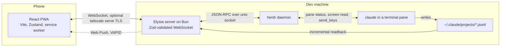

# CCMobile

A touch-first PWA that pushes [Claude Code](https://claude.ai/code) session status, permission prompts and replies to your phone over WebSocket, served by a Bun/Elysia server on your dev machine with optional Tailscale identity gating.

> *This project is not affiliated with or endorsed by Anthropic. Claude and Claude Code are trademarks of Anthropic.*

## The problem

Claude Code runs in a terminal on your dev machine. When it stops to ask for a permission, the session waits until someone is back at that keyboard. CCMobile closes that gap. Your phone can get a push when a session it drove blocks, shows the terminal's own options, and presses the key you tap in the real pane. It is not a terminal replacement but a touch translation of terminal interactions.

## Features

- **Permission prompts on the phone** — herdr reports the pane `blocked`, the server parses the prompt off the screen, and the chosen key is pressed in the pane. An unanswered prompt gets Esc after 90 s, and only on panes cc-mobile launched.
- **Every session on the machine** — the session list comes from herdr's `agent.list`, so a claude you started in your own terminal shows up on the phone and can be continued there.
- **Replies from the transcript** — read incrementally from claude's own `.jsonl` file and rendered as Markdown with Shiki highlighting and Mermaid diagrams.
- **Web push for the installed PWA** — a push when a session the phone drove blocks, and one merged push when its turns finish. No push goes to a phone that is already looking at the app. The lock-screen text names the project, never the work.
- **Quick actions** — pinnable slash commands and agents, plus `/` and `@` pickers fed by the commands, agents and plugins installed for Claude Code.
- **Image attachments** — PNG, JPEG and GIF uploads sent with a prompt.
- **Security posture** — an optional Tailscale identity gate, an always-on WebSocket origin check, a working-directory allowlist, and an audit log of every write that records the device and outcome but never the text. cc-mobile sets no agent permission flags itself, and a session running without a permission gate is marked `no permission gate`.

## Architecture



- **Stack**: Bun, Elysia, React 18, Vite, Zustand, Zod and web-push, in TypeScript throughout.
- **Terminal layer**: the herdr socket API drives a real `claude` in a persistent pane ([ADR-015](docs/adr/015-herdr-terminal-layer.md)). It is the only path to claude, so no API key is needed.
- **Permissions**: herdr reports `blocked`, the server parses the prompt off `pane.read`, the phone shows the terminal's own options, and `pane.send_keys` presses the chosen key.
- **Push**: triggered by herdr's raw `agent_status`, not by a permission card ([ADR-017](docs/adr/017-push-reads-raw-agent-status.md)).
- **State**: a Zustand store with per-session isolation ([ADR-008](docs/adr/008-zustand-multi-session-state.md)).
- **Validation**: Zod schemas for every WebSocket message ([ADR-001](docs/adr/001-zod-runtime-validation.md)).
- **Resilience**: an unreachable herdr daemon does not stop the server; it starts anyway and picks the daemon up when it comes online ([ADR-018](docs/adr/018-hangar-second-socket-and-push-scope.md)).

## Quick Start

Requirements:

- [Bun](https://bun.sh) runtime (v1.0+)
- [Claude Code CLI](https://claude.ai/code) installed locally (the `claude` binary)
- A running [herdr](https://herdr.dev) daemon (`brew install herdr`); cc-mobile drives claude entirely through its socket

```bash
# Clone the repo and install
git clone https://github.com/musingfox/cc-mobile.git
cd cc-mobile
bun install

# One-off: let herdr detect claude in a pane
herdr integration install claude

# Start backend (:3001) and frontend (:5173, network accessible) together
bun run serve
```

Open `http://localhost:5173` in your browser, or use your machine's IP or Tailscale address to reach it from your phone.

`herdr integration install claude` is what teaches herdr to report a pane's `agent_status`, and everything cc-mobile does hangs off that one signal. A permission prompt is a pane going `blocked`, a reply is read back when a pane settles, and the session list's activity dots are status changes. Without the integration the phone shows sessions that never seem to do anything.

## Configuration

### Server CLI Flags

```bash
bun run dev:server -- --port 4000 --default-cwd ~/workspace
```

| Flag | Default | Description |
|------|---------|-------------|
| `--port` | `3001` | Server port |
| `--default-cwd` | none | Default working directory for new sessions |
| `--hostname` | `0.0.0.0` | Server bind address |

**Security note**: cc-mobile sets no agent settings at all — it passes no permission or approval flag when launching, and the messages that used to adjust mode / model / effort / env vars are refused by the Zod gate. Each agent runs at whatever its own configuration says, exactly as it would if you had started it in your own terminal (ADR-003 superseded; see ADR-015 §2026-08-06).

The session list still *discloses* a pane running without a gate: a card marked `no permission gate` means that agent's own argv says it will not stop to ask. Disclosure, not control — cc-mobile reads that flag, it does not set it.

### Environment Variables

| Variable | Default | Description |
|----------|---------|-------------|
| `CC_MOBILE_ALLOWED_ROOTS` | none | Comma-separated list of allowed working directory roots. When set, sessions can only be created under these paths. Example: `CC_MOBILE_ALLOWED_ROOTS=~/workspace,~/projects` |
| `CC_MOBILE_TRUSTED_USER` | none | Tailnet login allowed to reach this server, compared against the `Tailscale-User-Login` header. When set, every request that does not carry it — HTTP **and** WebSocket upgrade — gets `403 forbidden: identity`. Unset (or whitespace-only) the check does not run at all. **Only meaningful behind `tailscale serve`**, which injects the header and strips a client-supplied one; do not set it when reaching the server through the Vite dev proxy, which injects nothing and would lock you out. Example: `CC_MOBILE_TRUSTED_USER=you@github` |
| `CC_MOBILE_ALLOWED_ORIGINS` | none | Comma-separated origins accepted on a WebSocket upgrade regardless of the same-origin rule. Only needed if the `Origin` a browser sends cannot match the `Host` the server sees (a proxy that rewrites `Host`). Example: `CC_MOBILE_ALLOWED_ORIGINS=https://dev-machine.tailnet.ts.net` |
| `CC_MOBILE_VAPID_PUBLIC_KEY`, `CC_MOBILE_VAPID_PRIVATE_KEY`, `CC_MOBILE_VAPID_SUBJECT` | none | VAPID keys for web push. Unset, `/api/push/public-key` answers 503. |

The optional second herdr socket (`CC_MOBILE_HANGAR_SESSION`), the launch API (`CC_MOBILE_LAUNCH_TOKEN`, `CC_MOBILE_VAULT_ROOT`), push scope and the audit log path are documented in [CLAUDE.md](CLAUDE.md).

## Network Access

### Tailscale (recommended)

Already have Tailscale on your dev machine and phone? Just access it:

```
Phone -> Tailscale -> dev-machine:5173
```

Service workers and web push need a secure context, which a plain-http LAN address is not. For the installed PWA, run a production build behind `tailscale serve`, which terminates TLS for the tailnet:

```bash
bun run build
bun run start -- --port 7701 --hostname 127.0.0.1
tailscale serve --bg 7701
```

Tailscale network membership is the auth by default. To narrow it to a single identity, set
`CC_MOBILE_TRUSTED_USER` to your tailnet login and reach the server through `tailscale serve` —
serve injects `Tailscale-User-Login` (on WebSocket upgrades too) and strips any copy a client
made up, and anything else is refused with `403 forbidden: identity`. Leave it unset for the
Vite dev proxy, which injects no such header.

Separately and always on: a WebSocket upgrade whose `Origin` does not match the request's `Host`
is refused with `403 forbidden: origin`, so no other site's page can open this server's socket.
Native clients, which send no `Origin`, are unaffected; `CC_MOBILE_ALLOWED_ORIGINS` is the escape
hatch if a proxy in front rewrites `Host`.

### Cloudflare Tunnel (alternative)

```bash
cloudflared tunnel --url http://localhost:3001
```

**Warning**: This exposes the service to the internet. Add auth (Cloudflare Access or similar) if using this method.

## Development

```bash
bun install              # Install dependencies
bun run dev:server       # Elysia backend on 0.0.0.0:3001
bun run dev:client       # Vite frontend on :5173 (add `-- --host` to reach it from the phone)
bun run serve            # Both of the above, Vite with --host
bun test                 # Run unit tests (bun:test) — hermetic, no daemon needed
bun run test:build       # PWA build check (rewrites dist/client)
bun run test:herdr       # Live e2e against a running herdr daemon + `claude` binary
bun run lint             # Biome check
bun run build            # Production build (dist/client/)
bun run start            # Production server: static files, WebSocket and API from one process
```

The Vite dev server proxies `/ws` and `/api` to the Elysia backend on port 3001. CI runs `bun test` and `bun run test:build` on every push and pull request.

### Project Structure

```
cc-mobile/
├── server/
│   ├── index.ts           # Entry: probes herdr, then listens
│   ├── app.ts             # Elysia app assembly
│   ├── config.ts          # CLI flag + env var parsing
│   ├── ws.ts              # WebSocket handler (Elysia plugin)
│   ├── protocol.ts        # Zod schemas for WS messages
│   ├── request-gate.ts    # Tailscale identity + origin gate
│   ├── herdr/             # herdr socket backend, pane events, permission parsing
│   ├── transcript/        # .jsonl path, incremental read, turn delivery
│   ├── push/              # Web push: scope, foreground suppression, payload, sender
│   ├── audit/             # Write audit log
│   ├── agents/            # Launchable agent kinds and profiles
│   └── capabilities/      # Commands, agents and plugins probe
├── client/
│   ├── App.tsx            # Layout
│   ├── main.tsx           # React entry
│   ├── components/linear/ # Screens: projects, sessions, chat, permission sheet, settings
│   ├── stores/            # Zustand stores
│   └── services/          # WebSocket, push, service worker, persistence
├── docs/adr/              # Architecture Decision Records
├── vite.config.ts
└── package.json
```

## Roadmap

### Completed

- **Phase 1**: Core loop — send messages, streaming response, approve/deny tools
- **Phase 2**: Quick actions — pinnable commands/agents, input autocomplete
- **Phase 3**: Multi-session — parallel sessions, saved projects
- **Phase 4**: Polish — settings, default CWD, pins, tool/agent activity display, path whitelist, e2e tests
- Haptic feedback on taps
- PWA manifest + service worker
- Production build: Elysia serves static files from one process
- Background web push for permission requests and finished turns

## Architecture Decision Records

ADR-015 onward cover the herdr terminal layer. Of the earlier ones, 001, 005 and 008 still describe the code; the rest record the path before herdr.

| ADR | Decision | Status |
|-----|----------|--------|
| [001](docs/adr/001-zod-runtime-validation.md) | Zod for runtime WebSocket message validation | Accepted |
| [002](docs/adr/002-permission-bridge-promise-pattern.md) | Promise + timeout pattern for permission relay | Accepted |
| [003](docs/adr/003-permission-mode-default.md) | Default to `"default"` permission mode | Superseded — cc-mobile sets no agent settings |
| [004](docs/adr/004-centralized-socket-hook.md) | Centralized socket hook | Superseded by ADR-008 |
| [005](docs/adr/005-elysia-ws-plugin-pattern.md) | Elysia WS plugin pattern for testability | Accepted |
| [006](docs/adr/006-plugin-loading-from-user-settings.md) | Plugin loading from ~/.claude/ settings | Accepted |
| [007](docs/adr/007-use-v1-query-api.md) | V1 query() API over V2 (plugin support) | Accepted |
| [008](docs/adr/008-zustand-multi-session-state.md) | Zustand store for multi-session state | Accepted |
| [009](docs/adr/009-websocket-reconnect-resilience.md) | WebSocket reconnect resilience | Accepted; heartbeat part superseded |
| [010](docs/adr/010-sdk-billing-response.md) | Response to the Agent SDK billing change | Proposed |
| [011](docs/adr/011-pty-sdk-hook-hybrid.md) | PTY driver + read-only SDK + hook gate hybrid | Accepted; module inventory superseded by ADR-015 |
| [012](docs/adr/012-zellij-integration-feasibility.md) | Zellij integration feasibility | Proposed |
| [013](docs/adr/013-session-lifecycle-model.md) | Session lifecycle model | Proposed; partly reversed by ADR-015 |
| [014](docs/adr/014-terminal-handoff-architecture.md) | Live terminal ↔ cc-mobile sharing | Superseded by ADR-015 |
| [015](docs/adr/015-herdr-terminal-layer.md) | herdr replaces tmux as the persistent terminal layer | Accepted |
| [016](docs/adr/016-session-view-as-transcript-projection.md) | The phone's session view is a projection of the transcript | Accepted |
| [017](docs/adr/017-push-reads-raw-agent-status.md) | Push reads herdr's raw status, not the permission card | Accepted |
| [018](docs/adr/018-hangar-second-socket-and-push-scope.md) | Second herdr socket (hangar), start when unreachable, always push for it | Accepted |

## Contributing

Feedback and contributions welcome! This project is in active development.

### Reporting Issues

Open an issue describing:
- What you expected vs what happened
- Steps to reproduce
- Your environment (OS, Bun version, Claude Code CLI version)

### Development Workflow

1. Fork and clone the repo
2. `bun install`
3. Run `bun test` to verify the test suite passes
4. Make your changes on a feature branch
5. Run `bun test` before submitting (and `bun run test:herdr` if you have a herdr daemon)
6. Open a PR with a clear description of the change

### Code Conventions

- TypeScript throughout (server + client)
- Zod schemas for all WebSocket message types
- Bun test throughout: hermetic unit tests, plus live herdr e2e under `server/integration/`
- Conventional commits (`feat:`, `fix:`, `refactor:`, `docs:`)

## License

[MIT](LICENSE)
